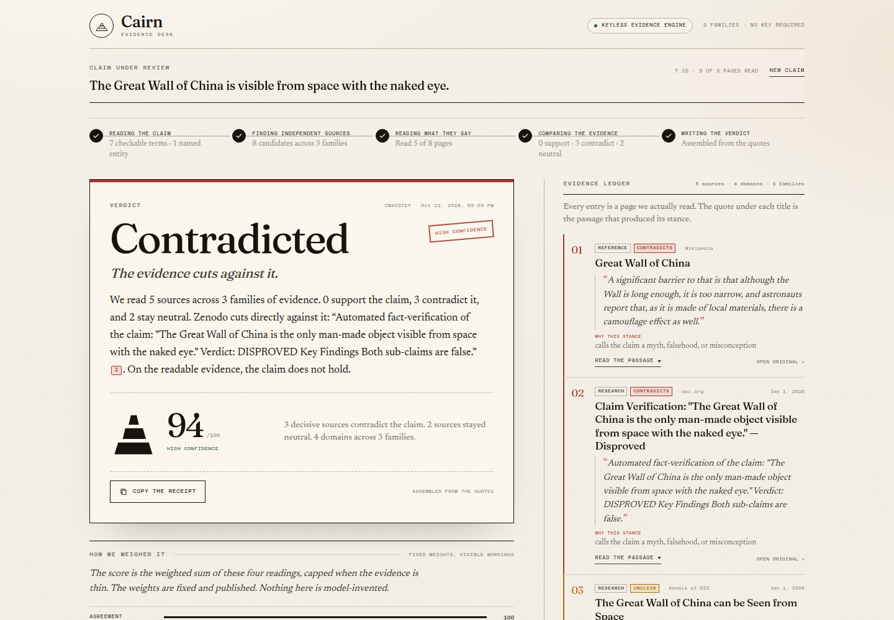
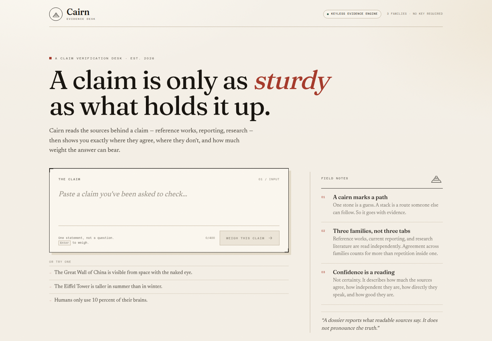
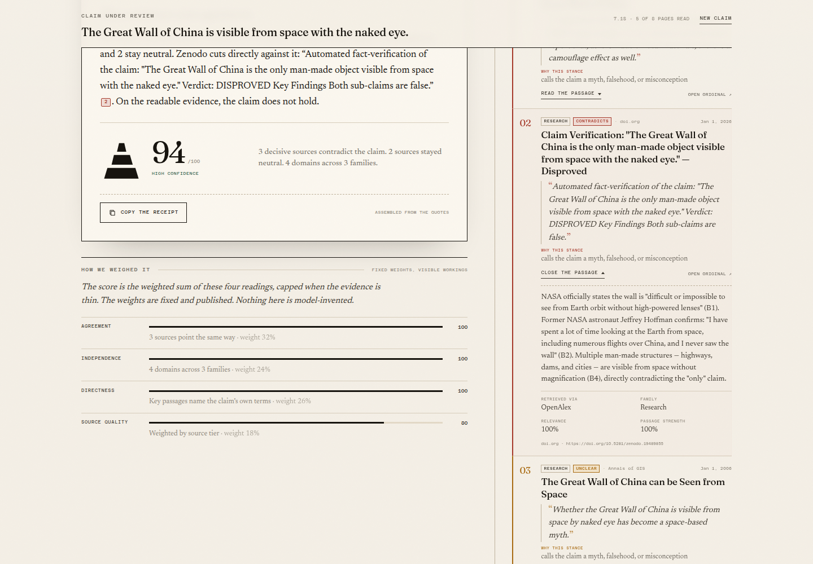

# Cairn

**A claim verification desk that shows what the answer is standing on.**

Cairn takes one factual claim, reads independent sources, quotes the passage that decided each reading, and returns a verdict with a confidence score you can inspect. It is not a chat interface, and it does not ask you to trust a paragraph.



## Why this exists

A wrong answer and a right answer look exactly the same in a chat window. Cairn makes the difference visible: every source carries the passage that produced its stance, every citation opens the evidence, and disagreement lowers the confidence instead of disappearing into fluent prose.

The name is the metaphor. A cairn is a stack of stones that marks a safe path; an answer is only as good as the stones under it.

## What it does

- Accepts one statement between 8 and 400 characters.
- Retrieves from three independent source families: reference, news, and research.
- Reads full pages rather than headlines, and drops pages it cannot read rather than guessing.
- Tags each source **Supports**, **Contradicts**, **Neutral**, or **Unclear**, with the deciding quote.
- Returns **Supported**, **Contradicted**, **Mixed**, or **Not enough evidence**.
- Derives confidence from four published factors: agreement, independence, directness, and source quality.
- Streams the work as it happens and lets a citation jump straight to its evidence.
- Copies a plain-text receipt with the verdict and numbered sources.
- Runs without an API key, account, database, or analytics.

## How it works

```
claim -> understand -> retrieve -> read and examine -> weigh -> compose -> dossier
```

1. **Understand.** Normalise the claim, extract named entities, separate the predicate from the subject, detect negation, and collect anchors such as numbers, percentages, and superlatives that a source must mention to be on topic.
2. **Retrieve.** Query the source families in parallel, deduplicate by URL and title, drop off-topic and disambiguation pages, and interleave families so one provider cannot crowd out an independent one.
3. **Read.** Fetch pages through an SSRF-safe reader, strip navigation and reference apparatus, and split the article into passages. JavaScript-only pages are dropped, not guessed at.
4. **Examine.** Score passages against the claim's concepts, require at least two distinct predicate concepts, and detect negation and explicit refutation cues near those concepts. The strongest passage becomes the quote.
5. **Weigh.** Weight each source by quality, relevance, and stance strength. The balance of support and contradiction produces the verdict; four factors produce the confidence.
6. **Compose.** Write two or three sentences from the counted stances and the clearest decisive quote, with citation markers that map to the ledger.

An optional LLM may rewrite the prose if a key is configured. The server still computes and validates the verdict, the stances, and every citation, and falls back to the deterministic text on any failure.

## Sources

| Family | Source | Key required | Role |
| --- | --- | --- | --- |
| Reference | Wikipedia | No | The article that usually carries the relevant section. |
| News | Bing News RSS | No | Current reporting; publisher URLs are decoded from Bing's redirect. |
| Research | OpenAlex | No | Abstracts from the literature; the title must name the subject. |
| Web | Brave Search or Tavily | Optional | General web search when configured. |

Wikimedia requests are serialised, spaced, cached, and backed off on HTTP 429. If a family is unavailable, the dossier proceeds with the others and says so.

## Confidence

```
score = 12 + 88 x (0.32 * agreement + 0.24 * independence + 0.26 * directness + 0.18 * quality)
```

The score is capped when the evidence is thin:

| Condition | Cap |
| --- | --- |
| Fewer than two decisive sources | 55 |
| Only one source family | 66 |
| Mixed verdict | 64 |
| Fewer than three domains | 76 |
| Fewer than four sources | 80 |
| Fewer than five sources | 88 |
| Not enough evidence | 34 |
| Absolute ceiling | 94 |

The four factors, their weights, and the rationale are printed in the dossier. Confidence is a reading of the evidence, not a claim of certainty, and the model is documented rather than hidden.

## Quick start

Requires Node.js 20.19 or newer and Git. No API key is needed.

```bash
git clone https://github.com/Nassami1/cairn.git
cd cairn
npm install
npm run build
npm start
```

Open <http://localhost:8787>.

For development with hot reload:

```bash
npm run dev
```

The Vite server runs on port 5173 and proxies `/api` to the API on port 8787. The production build is served by Express from one process.



## Configuration

Cairn works with no configuration. Copy `.env.example` to `.env` only if you want the optional paths.

| Variable | Effect |
| --- | --- |
| `PORT`, `HOST` | Where the server listens. Defaults to `127.0.0.1:8787`. |
| `CONTACT_EMAIL` | Contact in the Wikimedia user agent and the OpenAlex `mailto`. |
| `LLM_BASE_URL`, `LLM_API_KEY`, `LLM_MODEL` | OpenAI-compatible synthesis. The verdict and citations remain server-computed. |
| `BRAVE_API_KEY` or `TAVILY_API_KEY` | Adds general web search as a fourth family. |

The masthead badge reads **Keyless evidence engine** or **AI-assisted synthesis** depending on the server configuration.

## Tests

```bash
npm test          # 39 unit and integration tests, no network
npm run test:live # one real claim end to end; needs the public web
npm run typecheck # TypeScript checks for the client
```

The suite covers claim analysis, predicate concepts, nested negation, anchor gating, verdict thresholds, confidence caps, summary validation, HTML extraction, the SSRF guard, URL canonicalisation, caching, rate limiting, and the semaphore.

## Project layout

```
cairn/
├── server/
│   ├── engine/        # analyze, retrieve, extract, examine, weigh, compose, llm
│   ├── providers/     # wikipedia, news, openalex, websearch
│   ├── lib/           # text, http, domains, cache, rate limit
│   ├── routes/        # SSE and JSON endpoint, meta, health
│   └── test/          # node:test suites
├── src/
│   ├── components/    # Desk, Dossier, Verdict, Ledger, Factors, ...
│   ├── lib/           # SSE parser, receipt builder, formatting
│   └── styles/        # design tokens and layout
├── devpost/           # scope, prd, spec, checklist, app map
├── docs/              # screenshots used in this README
├── Dockerfile
├── LICENSE
└── README.md
```

## Evidence, not vibes



Every entry in the ledger is a page the server actually read. The quote under each title is the passage that produced its stance. Clicking a citation scrolls to that card, expands it, and shows the retrieval route and the outbound link.

## Security and privacy

- No accounts, analytics, cookies, or client-side storage.
- Claims are sent only to this server and then to the retrieval providers; results live in a 30-minute in-memory cache.
- Server-side fetching refuses non-HTTP(S) protocols, non-standard ports, loopback and private addresses, and metadata endpoints on every redirect hop.
- Input is capped at 400 characters and request bodies at 16 KB. Each IP is limited to ten checks per minute, and concurrent runs are bounded.
- The optional LLM receives only the claim and the quoted evidence. It has no tools, and its output is validated before display.

## Limitations

- **Stance detection is heuristic.** It reads negation, refutation cues, predicate concepts, and anchors. It can miss sarcasm, conditionals, and unusual phrasing. The quote is always shown so a reader can disagree with the tag.
- **Coverage is not completeness.** A dossier reports what readable sources said at the time it ran. Other sources may exist.
- **Not a truth machine.** Supported means the readable sources support the claim, not that the claim is objectively true.
- **Readability matters.** JavaScript-only and paywalled pages are dropped, and the run notes report how many.
- **Confidence is not calibrated** against a labelled claim set. The formula is deterministic and documented, which is the next best thing.
- **Rate limits are real.** If Wikimedia throttles a request, the dossier proceeds with the other families and the confidence caps reflect it.

## Build With AI: Basics

Built for the 2026 Devpost Learn hackathon. The planning documents produced with the Devpost Learn Skill Pack live in [`devpost/`](devpost/):

- [Scope](devpost/scope.md)
- [Product requirements](devpost/prd.md)
- [Technical spec](devpost/spec.md)
- [App map](devpost/app-map.html)

No pre-existing code was used. The demo video and submission are prepared separately.

## License

MIT. See [LICENSE](LICENSE).
